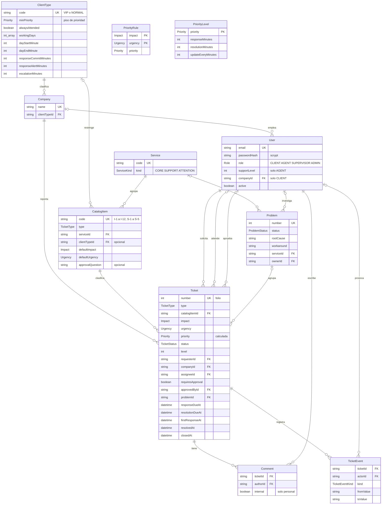

# Modelo de datos

La fuente de la verdad es `prisma/schema.prisma`. Este diagrama la resume; si cambia el esquema, actualizarlo en el mismo pull request.

Todas las tablas usan un `id` de texto como llave primaria, salvo `PriorityRule` y `PriorityLevel`; el diagrama lo omite.

## Grupos de tablas

* **Reglas del servicio.** `ClientType`, `PriorityRule`, `PriorityLevel`, `Service` y `CatalogItem`. Las carga `prisma/seed.ts` y el código las lee; no se editan desde la aplicación.
* **Personas.** `Company` y `User`. El tipo de cliente pertenece a la empresa; un usuario cliente pertenece a una empresa, y el personal de soporte no.
* **Atención.** `Ticket`, `Comment`, `TicketEvent` y `Problem`.

## Decisiones del modelo

* **`PriorityRule` y `PriorityLevel` no tienen relación con `Ticket`.** La prioridad se calcula al crear el ticket y se guarda en él; las reglas solo se consultan.
* **El ticket guarda sus vencimientos.** Así el SLA queda como dato y no solo en lógica, que fue una debilidad del backend de TechSupport Pro señalada en la Fase 1.
* **`TicketEvent` es el historial.** Cada cambio de estado, asignación, prioridad, nivel, aprobación o problema deja un registro. De ahí sale, por ejemplo, la primera transición a IN_PROGRESS que mide el SLO 2.
* **Borrados.** Al borrar un ticket se borran sus comentarios y eventos. Al borrar un problema, sus tickets quedan sin problema y no se borran.
